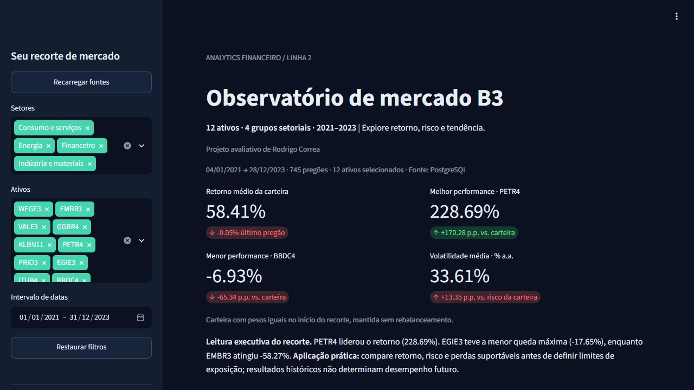
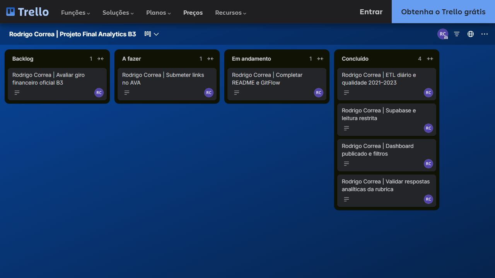

# Observatório de mercado B3

**Autor: Rodrigo Correa**

**Dashboard publicado:** [Abrir Observatório de mercado B3](https://rodrigo-correa-analytics-b3.streamlit.app/).
Validado em 31/10/2026, com acesso público e PostgreSQL no Supabase como fonte ativa.

Repositório de entrega: [rodrigodll46/projeto-final-analytics-b3](https://github.com/rodrigodll46/projeto-final-analytics-b3).
Branch estável de entrega: `main`. Integração em `develop`; correções em `feature/*`.
O histórico inicial em `codex/analytics-b3` foi preservado.

[](https://github.com/rodrigodll46/projeto-final-analytics-b3/actions/workflows/ci.yml)

Projeto Final de Analytics Financeiro · Linha 2 · Python, Streamlit e Plotly Express.
Compara 12 ativos brasileiros no período obrigatório **01/01/2021 a 31/12/2023**.
O dashboard utiliza PostgreSQL como fonte prioritária e CSV como contingência automática.

## Resumo executivo e contexto de negócio

Comparar somente o preço nominal de ações pode distorcer uma decisão: os ativos
partem de preços diferentes, têm eventos corporativos e perdas intermediárias
distintas. Este observatório compara o capital normalizado, a variabilidade dos
retornos e a profundidade das quedas de um universo fixo, com dados auditáveis.

**Pergunta orientadora:** quais ativos combinaram maior retorno com menor risco
histórico entre 2021 e 2023, e que perdas um investidor teria enfrentado no percurso?
O usuário principal é o analista ou gestor que precisa comparar exposições e
explicar os riscos observados antes de definir limites para uma carteira.

| Pergunta oficial da Linha 2 | Resposta disponível no app |
| --- | --- |
| Rentabilidade de um capital inicial igual | Performance: base 100 e retornos por ativo |
| Melhor relação de retorno e volatilidade | Dispersão e ranking em Conclusões, com razão acumulada e Sharpe empírico rf=0 |
| Dispersão, assimetria e caudas dos retornos | Histograma/boxplot e tabela de estatísticas em Conclusões |
| Drawdown máximo e ativo mais resiliente | Área por ativo, tabela de drawdown e síntese executiva |
| Fechamento frente às SMA 21 e 50 | Tendências: gráfico e posição no último pregão selecionado |

## Principais resultados e decisões apoiadas

Snapshot completo de 04/01/2021 a 28/12/2023, sem custos ou impostos:

| Achado calculado | Valor | Interpretação |
| --- | ---: | --- |
| Carteira com pesos iniciais iguais | 58,41% | Resultado acumulado sem rebalanceamento |
| PETR4: maior retorno | 228,69% | Base 100 terminou em 328,69 |
| BBDC4: menor retorno | -6,93% | Base 100 terminou em 93,07 |
| Volatilidade média dos ativos | 33,61% a.a. | Não equivale ao risco da carteira |
| PETR4: retorno acumulado / volatilidade anualizada | 5,80 | Maior razão observada; usa horizontes distintos, identificados |
| PETR4: Sharpe empírico com rf=0 | 1,22 | Maior média diária por unidade de desvio diário anualizada |
| EGIE3: drawdown menos severo | -17,65% | Mais resiliente por este critério, não por todos os critérios de risco |
| EMBR3: drawdown mais severo | -58,27% | Um retorno final elevado coexistiu com perdas intermediárias profundas |
| PETR4: percentil 5% dos retornos diários | -3,88% | Limiar empírico da cauda esquerda; não é perda máxima futura |
| PETR4: média da cauda 5% | -5,73% | Média dos dias no percentil 5% ou abaixo dele |

O gestor pode usar as conclusões para **comparar perfis de exposição**, o drawdown
para discutir tolerância a perdas e a matriz de correlação para investigar
concentrações. PETR4 ter liderado duas medidas no período não implica que liderará
no futuro. A baixa queda máxima de EGIE3 ajuda a explicar um perfil histórico mais
defensivo por essa medida, sem comprovar causas econômicas ou setoriais.

Os números são descritivos de um universo escolhido e de uma janela histórica.
Não demonstram causalidade, capacidade de previsão, adequação individual ou uma
estratégia investível após custos. A razão acumulada não é um Sharpe clássico.
O Sharpe aqui usa **rf=0**, sem alegar excedente ao CDI/Selic. A assimetria amostral
e a curtose não constituem testes de normalidade; quantis e correlações podem mudar.



## Guia de navegação

1. Abra o dashboard e confira a fonte ativa e o intervalo efetivo dos pregões.
2. Escolha setores, ativos e datas na lateral; os cartões e gráficos recalculam.
3. Em **Performance**, compare base 100 e risco/retorno; use a legenda e o zoom.
4. Em **Risco e distribuição**, examine histograma, drawdown e correlação.
5. Em **Tendências**, selecione um ativo para fechamento ajustado e SMA 21/50.
6. Em **Conclusões**, leia as cinco respostas e as estatísticas numéricas do recorte.
7. Em **Base de dados**, confira os registros e exporte o CSV filtrado.
8. Em **Metodologia**, consulte fórmulas e limites. **Restaurar filtros** recupera
   os 12 ativos e o período obrigatório; **Recarregar fontes** limpa o cache.

## Executar

Clone o projeto, depois execute a partir da raiz. Python 3.11 ou superior.

```powershell
git clone https://github.com/rodrigodll46/projeto-final-analytics-b3.git
cd projeto-final-analytics-b3
git switch main
python -m venv .venv
.\.venv\Scripts\python.exe -m pip install -r requirements.txt
.\.venv\Scripts\python.exe -m streamlit run app.py
```

Linux/macOS: use `.venv/bin/python` no lugar de `.venv\Scripts\python.exe`.
O snapshot real já está incluído em `data/`: não é necessário acessar o Yahoo
ou configurar banco para abrir o dashboard. Acesse o endereço exibido pelo Streamlit.
Se `venv` falhar no `ensurepip`, um Python com `pip` pode preparar o ambiente com
`python -m pip --python .venv install -r requirements.txt`.

## Atualizar a base

```powershell
.\.venv\Scripts\python.exe -m src.etl --refresh
```

O ETL consulta dados diários de `2021-01-01` até `2024-01-01` **exclusivo**,
com `auto_adjust=False`, mantendo `Adj Close` separado do OHLC.
Há até três tentativas por ativo. Falhas de aquisição ou qualidade impedem a
publicação de uma base parcial e preservam o CSV anterior.
Os dados são validados antes de substituir o CSV de forma atômica.
`data/manifest.json` registra provedor, versão, códigos consultados, cobertura e SHA-256.
O CSV usa UTF-8 e quebras de linha LF, preservando seu hash em Windows e Linux.
O CSV e o manifesto são substituídos individualmente; a verificação do hash detecta
eventual interrupção entre as duas gravações.

Snapshot inicial obtido em **30/10/2026**:

| Ano | Pregões por ativo | Registros dos 12 ativos |
| --- | ---: | ---: |
| 2021 | 247 | 2.964 |
| 2022 | 250 | 3.000 |
| 2023 | 248 | 2.976 |
| Total | 745 | 8.940 |

Primeiro pregão: 04/01/2021. Último: 28/12/2023. O intervalo solicitado inclui
os três anos civis completos; finais de semana e feriados não recebem linhas artificiais.
O provedor pode revisar preços históricos e ajustes em futuras extrações.

### Continuidade do ticker da Embraer

O contrato de dados e todos os filtros preservam **EMBR3**, conforme o enunciado.
Na extração inicial, `EMBR3.SA` retornou vazio no Yahoo; o histórico foi obtido
por `EMBJ3.SA`, código atual da mesma companhia. O ETL tenta primeiro o ticker
histórico e só então o alias explícito de `src/config.py`. Não utiliza ADR em dólar.
A origem efetiva de cada série consta no manifesto. A correspondência dos códigos
é documentada no [comunicado da própria Embraer, reproduzido publicamente](https://investidor10.com.br/acoes/link_comunicado/embj3/23796/)
e o código atual está confirmado no [RI da Embraer](https://ri.embraer.com.br/governanca/composicao-acionaria-2/).

## Universo e grupos setoriais

| Grupo didático | Ativos |
| --- | --- |
| Indústria e materiais | WEGE3, EMBR3, VALE3, GGBR4, KLBN11 |
| Energia | PETR4, PRIO3, EGIE3 |
| Financeiro | ITUB4, BBDC4 |
| Consumo e serviços | ABEV3, RENT3 |

São quatro **agrupamentos didáticos**, não quatro setores oficiais da B3.
O enunciado não forneceu o mapeamento dos setores. KLBN11 é uma unit; o termo
“ativos” é usado na interface para representar corretamente o universo proposto.

## Dicionário de dados

Uma linha por `(Data, Ativo)`. Ordenação por data e ativo.

| Coluna | Tipo | Significado |
| --- | --- | --- |
| Data | data | Data do pregão, sem fuso e sem horário |
| Ativo | texto | Código histórico do universo, sem `.SA` |
| Setor | texto | Grupo didático definido em `src/config.py` |
| Open / High / Low | decimal | Abertura, máxima e mínima, em reais, conforme o Yahoo |
| Close | decimal | Fechamento retornado com `auto_adjust=False` |
| Adj Close | decimal | Fechamento ajustado pelo Yahoo para eventos corporativos |
| Volume | inteiro | Quantidade negociada informada pelo Yahoo |
| Volume Financeiro | decimal | **Estimativa** em reais: `Close × Volume` |

**Volume Financeiro não é giro oficial da B3.** O Yahoo não fornece aqui a soma
financeira exata das operações. `Close × Volume` aproxima essa grandeza; ajustes
de desdobramentos do provedor também afetam sua interpretação. A estimativa é
identificada no dashboard, no ETL e no manifesto. Para exigir giro oficial,
seria necessário substituir essa variável por dados oficiais da B3 e adaptar
seu contrato de validação.

### Fonte e direitos de uso

As cotações são obtidas do **Yahoo Finance por yfinance**, conforme a alternativa
permitida no item da Linha 2 do PDF. Não são uma extração direta de COTAHIST.
O [projeto yfinance](https://ranaroussi.github.io/yfinance/) informa que a API
financeira se destina a uso pessoal e remete aos termos do Yahoo para os direitos
sobre os dados. A licença do software yfinance é distinta dos direitos sobre as
cotações. Este projeto tem finalidade acadêmica e não concede uma licença aberta
ou comercial sobre dados de terceiros. Consulte os
[termos indicados pelo provedor](https://legal.yahoo.com/us/en/yahoo/terms/product-atos/apiforydn/index.html)
antes de reutilizar ou redistribuir os dados; a disponibilidade de download não
certifica uma autorização geral de uso.

Validações: colunas obrigatórias, tipos, finitude, preços positivos, relação OHLC,
volumes não negativos, volume em unidades inteiro, consistência da estimativa,
chaves únicas, universo, setores e período. A cobertura exige pelo menos 230
observações por ativo/ano, presença nas extremidades de cada ano e calendários
iguais entre ativos. Esse controle detecta lacunas individuais, mas não certifica
sozinho um pregão ausente simultaneamente nas 12 séries contra o calendário oficial.
Não há forward fill, interpolação ou descarte silencioso de linhas inválidas.

## Indicadores e gráficos

As fórmulas usam **Adj Close** e retornos simples, com 252 pregões de referência.

- Base 100: `100 × P(t) / P(inicial)`, com linha horizontal no nível 100.
- Retorno acumulado: `(P(final) / P(inicial) - 1) × 100`.
- Volatilidade anualizada: `std(retornos diários, ddof=1) × sqrt(252) × 100`.
- Drawdown na janela: `(P(t) / cummax(P) - 1) × 100`; o topo reinicia no recorte.
- SMA 21 e 50: média dos últimos 21/50 preços ajustados, incluindo o pregão atual.
- Retorno/risco acumulado: retorno acumulado dividido pela volatilidade anualizada,
  usando ambos em %; comparável somente para a mesma janela e metodologia.
- Sharpe empírico rf=0: `mean(r_diário) / std(r_diário, ddof=1) × sqrt(252)`.
- Distribuição: média, desvio amostral, assimetria, curtose de Fisher (normal = 0),
  quantis 1/5/50/95/99%, pior dia e média dos retornos no percentil 5% ou abaixo.
- Correlação: Pearson sobre os retornos diários alinhados do recorte.

Divisão por risco nulo resulta em estimativa indisponível, nunca infinito.
Assimetria requer ao menos três retornos, curtose quatro e correlação três.
O Sharpe não usa taxa livre de risco externa; rf=0 é uma hipótese explícita.

A carteira tem pesos iguais **no início de cada recorte** e é mantida sem
rebalanceamento. Sua série é a média das séries normalizadas; seu retorno
é igual à média dos retornos acumulados dos ativos. A volatilidade média dos
ativos é apresentada separadamente do risco dessa carteira.
Não são considerados taxas e impostos. O universo escolhido pode gerar viés de seleção.

O retorno diário é recalculado após o filtro: o primeiro dia não inclui retorno
iniciado fora da janela. As médias móveis são calculadas antes do filtro, usando
somente passado e presente. No início de 2021, ficam indisponíveis até completar
as respectivas janelas; não se busca histórico fora do período obrigatório.
São necessários três pregões para dois retornos e uma volatilidade amostral válida.

Quatro cartões com deltas:

| Cartão | Valor | Delta |
| --- | --- | --- |
| Retorno médio da carteira | Retorno acumulado da carteira | Retorno da carteira no último pregão |
| Melhor performance | Ativo de maior retorno e seu retorno | Diferença em p.p. contra a carteira |
| Menor performance | Ativo de menor retorno e seu retorno | Diferença em p.p. contra a carteira |
| Volatilidade anualizada média | Média das volatilidades individuais | Diferença em p.p. contra a volatilidade da carteira |

Seis gráficos em **Plotly Express**: linha base 100, dispersão risco/retorno com
bolhas proporcionais ao volume financeiro médio estimado, histograma de retornos
em frequência percentual com boxplot marginal, área de drawdown em facetas sem
empilhamento entre ativos, linhas de preço ajustado/SMA 21/SMA 50 e matriz de
correlação dos retornos. A interface tem seis abas, incluindo Conclusões.

Os filtros de setor, ativos e datas usam `st.session_state`. Trocar setores remove
ativos incompatíveis da seleção; reintroduzir um setor disponibiliza seus ativos
para nova seleção. **Restaurar filtros** recupera todo o universo e período.
O botão de download exporta exatamente a base filtrada, sem índice e em UTF-8 com BOM.

## PostgreSQL opcional e segurança

1. Copie `.streamlit/secrets.toml.example` para `.streamlit/secrets.toml`.
2. Preencha suas credenciais e mantenha TLS (`sslmode=require`).
3. Para criar/carregar a tabela, execute:

```powershell
.\.venv\Scripts\python.exe -m src.etl --upload
```

As credenciais vêm de **st.secrets**, consumidas pela conexão
`st.connection("postgresql", type="sql")`. O arquivo real está no `.gitignore`.
O exemplo contém somente placeholders. Na nuvem, configure os mesmos campos no
gerenciador de secrets do Streamlit; não inclua senha em URL pública ou README.

A tabela `b3_prices` tem chave primária `(data, ativo)`. A carga faz upsert
transacional com SQLAlchemy/PostgreSQL, sem apagar a tabela. Para separar permissões,
use uma conta de carga com escrita ao executar o ETL e uma conta apenas de leitura
no dashboard. A aplicação não executa carga ao abrir ou alterar filtros.

Quando `[connections.postgresql_admin]` está configurada localmente, o ETL usa
essa conexão para a carga. A leitura da aplicação continua usando somente
`[connections.postgresql]`. Sem a seção administrativa, a carga mantém o
comportamento original e usa `postgresql`. Na nuvem, publique apenas a conexão
de leitura, sem o bloco administrativo.

O carregador primeiro tenta o banco e valida sua resposta. Qualquer falha de
conexão, consulta ou integridade aciona o CSV. Se ambas as fontes falharem,
a interface informa como gerar a base e interrompe os gráficos de forma controlada.
Mensagens de conexão brutas não são exibidas, pois podem conter dados sensíveis.
Configure `connect_timeout` no secret para limitar a espera de conexão.

Leituras, validação, aquisição, cálculos, filtros e serialização pesada utilizam
`@st.cache_data(ttl=3600)`. A consulta SQL também recebe `ttl=3600`.
**Recarregar fontes** limpa todos os caches de dados, incluindo o cache interno
da consulta SQL, e reinicializa a conexão. Uma carga explícita no banco também
invalida todas as camadas de cache no processo que realizou a escrita.
Após uma substituição do CSV, seu timestamp invalida os caches do carregador
e do leitor local, permitindo usar o novo snapshot imediatamente.

## Arquitetura

```text
.
├── .github/workflows/ci.yml
├── .streamlit/
│   ├── config.toml
│   └── secrets.toml.example
├── data/
│   ├── b3_2021_2023.csv
│   └── manifest.json
├── notebooks/eda_exploratoria.ipynb
├── src/
│   ├── __init__.py
│   ├── config.py
│   ├── schema.py
│   ├── etl.py
│   ├── database.py
│   ├── analytics.py
│   └── charts.py
├── tests/
├── .gitignore
├── app.py
├── pyproject.toml
├── requirements.txt
├── requirements-dev.txt
└── README.md
```

Fluxo: Yahoo → ETL → validação → CSV/manifesto → carga PostgreSQL opcional.
Dashboard: PostgreSQL → CSV em caso de falha → indicadores → filtros → Plotly/CSV.
A camada analítica não depende da conexão de banco, e os gráficos não adquirem dados.
Todos os caminhos de dados são relativos à raiz; o notebook ajusta o diretório
de trabalho por caminhos relativos quando aberto em `notebooks/`.

### Modelagem e tecnologias

O grão da tabela de fatos `b3_prices` é **um ativo por pregão**, com chave
composta `(data, ativo)`. O universo e o mapeamento de grupos são dimensões
controladas em `src/config.py`; o calendário é derivado das datas negociadas.
A tabela física é desnormalizada para este pequeno conjunto, evitando joins
desnecessários. Não se apresenta essa escolha como um esquema estrela físico.

| Tecnologia | Papel e justificativa |
| --- | --- |
| Python, pandas e NumPy | ETL vetorizado, tipos, séries temporais e estatística reproduzível |
| yfinance | Aquisição diária permitida pela Linha 2, com preços ajustados separados |
| PostgreSQL/Supabase | Persistência transacional, chave composta e permissões de leitura |
| SQLAlchemy e psycopg | SQL parametrizado e upsert atômico/idempotente |
| Streamlit Community Cloud | Data app público, filtros reativos, estado, cache e secrets |
| Plotly Express | Seis visuais interativos com eixos e unidades identificados |
| Jupyter, pytest e Ruff | EDA executável, testes de fórmulas/contingência e qualidade estática |
| GitHub Actions e Trello | Verificação contínua, PRs e rastreabilidade das entregas |

## Notebook e validação

```powershell
.\.venv\Scripts\python.exe -m pip install -r requirements-dev.txt
.\.venv\Scripts\python.exe -m ruff check .
.\.venv\Scripts\python.exe -m ruff format --check .
.\.venv\Scripts\python.exe -m pytest -q
```

Abra `notebooks/eda_exploratoria.ipynb` no VS Code/Jupyter com o kernel da `.venv`
e execute todas as células. A EDA verifica contrato, hash, cobertura anual, ausência
de nulos/duplicatas, estatísticas, performance, distribuição, correlação e drawdown.
O notebook usa o snapshot local: não dispara download nem escreve no banco.

Os testes usam dados sintéticos somente em memória/arquivos temporários e não
dependem de acesso à internet. Cobrem fórmulas conhecidas, fronteiras dos filtros,
ausência de look-ahead, qualidade, fallback, sigilo das mensagens, ETL e interação
com os widgets por meio do simulador oficial `AppTest`.
A CI executa lint, formatação e testes em Python 3.11 e 3.12 no GitHub.
A integração em PostgreSQL 16 verifica upsert, leitura e idempotência em um
container descartável. Os três jobs passaram na execução registrada em VALIDACAO.md.
Validação local inicial: Python 3.14.3; versões efetivamente utilizadas registradas
em `VALIDACAO.md`. A integração real com o Supabase também foi validada:
8.940 registros conferidos contra o CSV, com conexão somente de leitura no app público.

## Git e entrega acadêmica

O desenvolvimento inicial foi registrado em `codex/analytics-b3`. Após a leitura
do PDF original, a revisão passou a usar **features a partir de develop**, PRs
para integração e entrega estável em **main**. As branches são mantidas e o
histórico anterior não foi reescrito para simular um fluxo que ainda não existia.
Exemplo para futuras alterações, depois da avaliação:

```text
git switch develop
git pull --ff-only origin develop
git switch -c feature/nome-da-tarefa
git add arquivos-da-tarefa
git commit -m "feat: implementa objetivo especifico"
git push -u origin feature/nome-da-tarefa
# Abrir PR para develop; após validar, abrir PR de develop para main.
# Preservar as branches após a integração.
```

Revise o conteúdo com `git diff --cached` antes de cada commit. O Git ignora
ambiente virtual e credenciais. Os commits não usam datas retroativas.

| Critério solicitado | Evidência preparada |
| --- | --- |
| ETL | 12 ativos, 3 anos diários, validação, tentativas, snapshot auditável |
| Streamlit | Filtros, reset, estado, seis abas, quatro métricas com deltas, exportação |
| Plotly | Seis famílias de gráficos, eixos/unidades e interatividade |
| Arquitetura | Aquisição, qualidade, banco, cálculo e gráficos em módulos separados |
| Resiliência | PostgreSQL prioritário, fallback CSV, cache e estados vazios tratados |
| Git | Autoria identificada, commits por responsabilidade, ignore e CI |

O PDF original foi recebido e comparado em 31/10/2026. A
[auditoria da rubrica](docs/CHECKLIST_AVALIACAO.md) identifica requisitos atendidos,
limites do histórico anterior e pendências da entrega. A nota depende do avaliador.

## Gestão ágil e links da entrega

- [GitHub público](https://github.com/rodrigodll46/projeto-final-analytics-b3).
- [Dashboard em produção](https://rodrigo-correa-analytics-b3.streamlit.app/).
- [Trello individual de Rodrigo Correa](https://trello.com/b/4qqJDupe/rodrigo-correa-projeto-final-analytics-b3).
- **Vídeo:** não incluído por decisão expressa do autor. O requisito de pitch
  de 3 a 5 minutos, que vale 1,0 ponto, permanece sem atendimento.



O quadro é dedicado a este projeto e tem Backlog, A fazer, Em andamento e Concluído.
Cada cartão contém responsável, especificações e critérios de aceite. Apenas uma
tarefa fica Em andamento. Foi criado durante a revisão do PDF: entregas prévias
foram registradas retrospectivamente e identificadas como tal, sem datas inventadas.
A captura representa uma etapa da revisão; o estado atual fica disponível no link.

**Prazo oficial:** 03/11/2026 às 22h, na atividade das Semanas 13 e 14 do AVA.
O envio no AVA ainda precisa de comprovação. O PDF considera a última atualização
do GitHub como data final e veda alterações depois da entrega até a nota.
Conclua as pendências antes de submeter e preserve a versão enviada.

## Autoria e créditos

Projeto acadêmico de **Rodrigo Correa** ·
[LinkedIn](https://www.linkedin.com/in/rodrigo-correa-a5009b247/) ·
[GitHub](https://github.com/rodrigodll46).
O desenvolvimento recebeu assistência de IA; a revisão, compreensão dos cálculos
e demonstração acadêmica cabem ao estudante. Os commits registram alterações reais,
sem comprovar por si sós domínio individual ou substituir a avaliação de autoria.
As fontes de dados, bibliotecas e documentações estão referenciadas neste README.

## Banco, publicação e apresentação

O [guia de publicação](docs/PUBLICACAO.md) descreve Supabase e Streamlit Community Cloud,
incluindo configuração segura, carga do CSV e conferência de todos os registros.
O comando `python -m src.database --upload-csv` carrega o snapshot já adquirido.
`python -m src.database` confere a igualdade entre banco e CSV, sem nova carga.

A [apresentação revisada](artifacts/Apresentacao_Rodrigo_Correa_B3_Revisada.pptx) contém resultados
calculados do snapshot e gráficos editáveis. O [roteiro](docs/ROTEIRO_APRESENTACAO.md)
inclui demonstração, metodologia e respostas às perguntas mais prováveis.
A apresentação é material de apoio e não substitui o vídeo exigido no PDF.
Os [resultados estatísticos](docs/estatisticas.json) e o notebook permitem conferir
as métricas numéricas da revisão. O [guia de envio](docs/ENTREGA_AVA.md) reúne os
links existentes e a pendência de submissão.

## Referências técnicas

- [yfinance.download: parâmetros e data final exclusiva](https://ranaroussi.github.io/yfinance/reference/api/yfinance.download.html)
- [Streamlit: st.connection](https://docs.streamlit.io/develop/api-reference/connections/st.connection)
- [Streamlit: SQLConnection](https://docs.streamlit.io/develop/api-reference/connections/st.connections.sqlconnection)
- [Streamlit: st.cache_data](https://docs.streamlit.io/develop/api-reference/caching-and-state/st.cache_data)
- [Streamlit: secrets](https://docs.streamlit.io/deploy/concepts/secrets)
- [pandas: assimetria amostral](https://pandas.pydata.org/docs/reference/api/pandas.Series.skew.html)
- [pandas: curtose de Fisher](https://pandas.pydata.org/docs/reference/api/pandas.Series.kurt.html)
- [Supabase: PostgreSQL e pooler](https://supabase.com/docs/guides/database/connecting-to-postgres)
