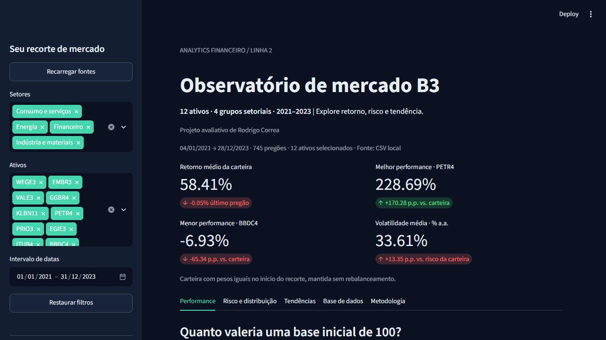

# Observatório de mercado B3

**Autor: Rodrigo Correa**

Repositório de entrega: [rodrigodll46/projeto-final-analytics-b3](https://github.com/rodrigodll46/projeto-final-analytics-b3).
Branch de entrega: `codex/analytics-b3`.

[](https://github.com/rodrigodll46/projeto-final-analytics-b3/actions/workflows/ci.yml)

Projeto Final de Analytics Financeiro · Linha 2 · Python, Streamlit e Plotly Express.
Compara 12 ativos brasileiros no período obrigatório **01/01/2021 a 31/12/2023**.
O dashboard utiliza PostgreSQL como fonte prioritária e CSV como contingência automática.



## Executar

Abra um terminal **na raiz do repositório**. Python 3.11 ou superior.

```powershell
python -m venv .venv
.\.venv\Scripts\python.exe -m pip install -r requirements.txt
.\.venv\Scripts\python.exe -m streamlit run app.py
```

Linux/macOS: use `.venv/bin/python` no lugar de `.venv\Scripts\python.exe`.
O snapshot real já está incluído em `data/`: não é necessário acessar o Yahoo
ou configurar banco para abrir o dashboard. Acesse o endereço exibido pelo Streamlit.
Se `venv` falhar no `ensurepip`, um Python com `pip` pode preparar o ambiente com
`python -m pip --python .venv install -r requirements.txt`.

## Atualizar a base

```powershell
.\.venv\Scripts\python.exe -m src.etl --refresh
```

O ETL consulta dados diários de `2021-01-01` até `2024-01-01` **exclusivo**,
com `auto_adjust=False`, mantendo `Adj Close` separado do OHLC.
Há até três tentativas por ativo. Falhas de aquisição ou qualidade impedem a
publicação de uma base parcial e preservam o CSV anterior.
Os dados são validados antes de substituir o CSV de forma atômica.
`data/manifest.json` registra provedor, versão, códigos consultados, cobertura e SHA-256.
O CSV usa UTF-8 e quebras de linha LF, preservando seu hash em Windows e Linux.
O CSV e o manifesto são substituídos individualmente; a verificação do hash detecta
eventual interrupção entre as duas gravações.

Snapshot inicial obtido em **30/10/2026**:

| Ano | Pregões por ativo | Registros dos 12 ativos |
| --- | ---: | ---: |
| 2021 | 247 | 2.964 |
| 2022 | 250 | 3.000 |
| 2023 | 248 | 2.976 |
| Total | 745 | 8.940 |

Primeiro pregão: 04/01/2021. Último: 28/12/2023. O intervalo solicitado inclui
os três anos civis completos; finais de semana e feriados não recebem linhas artificiais.
O provedor pode revisar preços históricos e ajustes em futuras extrações.

### Continuidade do ticker da Embraer

O contrato de dados e todos os filtros preservam **EMBR3**, conforme o enunciado.
Na extração inicial, `EMBR3.SA` retornou vazio no Yahoo; o histórico foi obtido
por `EMBJ3.SA`, código atual da mesma companhia. O ETL tenta primeiro o ticker
histórico e só então o alias explícito de `src/config.py`. Não utiliza ADR em dólar.
A origem efetiva de cada série consta no manifesto. A correspondência dos códigos
é documentada no [comunicado da própria Embraer, reproduzido publicamente](https://investidor10.com.br/acoes/link_comunicado/embj3/23796/)
e o código atual está confirmado no [RI da Embraer](https://ri.embraer.com.br/governanca/composicao-acionaria-2/).

## Universo e grupos setoriais

| Grupo didático | Ativos |
| --- | --- |
| Indústria e materiais | WEGE3, EMBR3, VALE3, GGBR4, KLBN11 |
| Energia | PETR4, PRIO3, EGIE3 |
| Financeiro | ITUB4, BBDC4 |
| Consumo e serviços | ABEV3, RENT3 |

São quatro **agrupamentos didáticos**, não quatro setores oficiais da B3.
O enunciado não forneceu o mapeamento dos setores. KLBN11 é uma unit; o termo
“ativos” é usado na interface para representar corretamente o universo proposto.

## Dicionário de dados

Uma linha por `(Data, Ativo)`. Ordenação por data e ativo.

| Coluna | Tipo | Significado |
| --- | --- | --- |
| Data | data | Data do pregão, sem fuso e sem horário |
| Ativo | texto | Código histórico do universo, sem `.SA` |
| Setor | texto | Grupo didático definido em `src/config.py` |
| Open / High / Low | decimal | Abertura, máxima e mínima, em reais, conforme o Yahoo |
| Close | decimal | Fechamento retornado com `auto_adjust=False` |
| Adj Close | decimal | Fechamento ajustado pelo Yahoo para eventos corporativos |
| Volume | inteiro | Quantidade negociada informada pelo Yahoo |
| Volume Financeiro | decimal | **Estimativa** em reais: `Close × Volume` |

**Volume Financeiro não é giro oficial da B3.** O Yahoo não fornece aqui a soma
financeira exata das operações. `Close × Volume` aproxima essa grandeza; ajustes
de desdobramentos do provedor também afetam sua interpretação. A estimativa é
identificada no dashboard, no ETL e no manifesto. Para exigir giro oficial,
seria necessário substituir essa variável por dados oficiais da B3 e adaptar
seu contrato de validação.

Validações: colunas obrigatórias, tipos, finitude, preços positivos, relação OHLC,
volumes não negativos, volume em unidades inteiro, consistência da estimativa,
chaves únicas, universo, setores e período. A cobertura exige pelo menos 230
observações por ativo/ano, presença nas extremidades de cada ano e calendários
iguais entre ativos. Esse controle detecta lacunas individuais, mas não certifica
sozinho um pregão ausente simultaneamente nas 12 séries contra o calendário oficial.
Não há forward fill, interpolação ou descarte silencioso de linhas inválidas.

## Indicadores e gráficos

As fórmulas usam **Adj Close** e retornos simples, com 252 pregões de referência.

- Base 100: `100 × P(t) / P(inicial)`, com linha horizontal no nível 100.
- Retorno acumulado: `(P(final) / P(inicial) - 1) × 100`.
- Volatilidade anualizada: `std(retornos diários, ddof=1) × sqrt(252) × 100`.
- Drawdown na janela: `(P(t) / cummax(P) - 1) × 100`; o topo reinicia no recorte.
- SMA 21 e 50: média dos últimos 21/50 preços ajustados, incluindo o pregão atual.

A carteira tem pesos iguais **no início de cada recorte** e é mantida sem
rebalanceamento. Sua série é a média das séries normalizadas; seu retorno
é igual à média dos retornos acumulados dos ativos. A volatilidade média dos
ativos é apresentada separadamente do risco dessa carteira.
Não são considerados taxas e impostos. O universo escolhido pode gerar viés de seleção.

O retorno diário é recalculado após o filtro: o primeiro dia não inclui retorno
iniciado fora da janela. As médias móveis são calculadas antes do filtro, usando
somente passado e presente. No início de 2021, ficam indisponíveis até completar
as respectivas janelas; não se busca histórico fora do período obrigatório.
São necessários três pregões para dois retornos e uma volatilidade amostral válida.

Quatro cartões com deltas:

| Cartão | Valor | Delta |
| --- | --- | --- |
| Retorno médio da carteira | Retorno acumulado da carteira | Retorno da carteira no último pregão |
| Melhor performance | Ativo de maior retorno e seu retorno | Diferença em p.p. contra a carteira |
| Menor performance | Ativo de menor retorno e seu retorno | Diferença em p.p. contra a carteira |
| Volatilidade anualizada média | Média das volatilidades individuais | Diferença em p.p. contra a volatilidade da carteira |

Cinco gráficos em **Plotly Express**: linha base 100, dispersão risco/retorno com
bolhas proporcionais ao volume financeiro médio estimado, histograma de retornos
em frequência percentual com boxplot marginal, área de drawdown em facetas sem
empilhamento entre ativos e linhas de preço ajustado/SMA 21/SMA 50.

Os filtros de setor, ativos e datas usam `st.session_state`. Trocar setores remove
ativos incompatíveis da seleção; reintroduzir um setor disponibiliza seus ativos
para nova seleção. **Restaurar filtros** recupera todo o universo e período.
O botão de download exporta exatamente a base filtrada, sem índice e em UTF-8 com BOM.

## PostgreSQL opcional e segurança

1. Copie `.streamlit/secrets.toml.example` para `.streamlit/secrets.toml`.
2. Preencha suas credenciais e mantenha TLS (`sslmode=require`).
3. Para criar/carregar a tabela, execute:

```powershell
.\.venv\Scripts\python.exe -m src.etl --upload
```

As credenciais vêm de **st.secrets**, consumidas pela conexão
`st.connection("postgresql", type="sql")`. O arquivo real está no `.gitignore`.
O exemplo contém somente placeholders. Na nuvem, configure os mesmos campos no
gerenciador de secrets do Streamlit; não inclua senha em URL pública ou README.

A tabela `b3_prices` tem chave primária `(data, ativo)`. A carga faz upsert
transacional com SQLAlchemy/PostgreSQL, sem apagar a tabela. Para separar permissões,
use uma conta de carga com escrita ao executar o ETL e uma conta apenas de leitura
no dashboard. A aplicação não executa carga ao abrir ou alterar filtros.

Quando `[connections.postgresql_admin]` está configurada localmente, o ETL usa
essa conexão para a carga. A leitura da aplicação continua usando somente
`[connections.postgresql]`. Sem a seção administrativa, a carga mantém o
comportamento original e usa `postgresql`. Na nuvem, publique apenas a conexão
de leitura, sem o bloco administrativo.

O carregador primeiro tenta o banco e valida sua resposta. Qualquer falha de
conexão, consulta ou integridade aciona o CSV. Se ambas as fontes falharem,
a interface informa como gerar a base e interrompe os gráficos de forma controlada.
Mensagens de conexão brutas não são exibidas, pois podem conter dados sensíveis.
Configure `connect_timeout` no secret para limitar a espera de conexão.

Leituras, validação, aquisição, cálculos, filtros e serialização pesada utilizam
`@st.cache_data(ttl=3600)`. A consulta SQL também recebe `ttl=3600`.
**Recarregar fontes** limpa todos os caches de dados, incluindo o cache interno
da consulta SQL, e reinicializa a conexão. Uma carga explícita no banco também
invalida todas as camadas de cache no processo que realizou a escrita.
Após uma substituição do CSV, seu timestamp invalida os caches do carregador
e do leitor local, permitindo usar o novo snapshot imediatamente.

## Arquitetura

```text
.
├── .github/workflows/ci.yml
├── .streamlit/
│   ├── config.toml
│   └── secrets.toml.example
├── data/
│   ├── b3_2021_2023.csv
│   └── manifest.json
├── notebooks/eda_exploratoria.ipynb
├── src/
│   ├── __init__.py
│   ├── config.py
│   ├── schema.py
│   ├── etl.py
│   ├── database.py
│   ├── analytics.py
│   └── charts.py
├── tests/
├── .gitignore
├── app.py
├── pyproject.toml
├── requirements.txt
├── requirements-dev.txt
└── README.md
```

Fluxo: Yahoo → ETL → validação → CSV/manifesto → carga PostgreSQL opcional.
Dashboard: PostgreSQL → CSV em caso de falha → indicadores → filtros → Plotly/CSV.
A camada analítica não depende da conexão de banco, e os gráficos não adquirem dados.
Todos os caminhos de dados são relativos à raiz; o notebook ajusta o diretório
de trabalho por caminhos relativos quando aberto em `notebooks/`.

## Notebook e validação

```powershell
.\.venv\Scripts\python.exe -m pip install -r requirements-dev.txt
.\.venv\Scripts\python.exe -m ruff check .
.\.venv\Scripts\python.exe -m ruff format --check .
.\.venv\Scripts\python.exe -m pytest -q
```

Abra `notebooks/eda_exploratoria.ipynb` no VS Code/Jupyter com o kernel da `.venv`
e execute todas as células. A EDA verifica contrato, hash, cobertura anual, ausência
de nulos/duplicatas, estatísticas, performance, distribuição, correlação e drawdown.
O notebook usa o snapshot local: não dispara download nem escreve no banco.

Os testes usam dados sintéticos somente em memória/arquivos temporários e não
dependem de acesso à internet. Cobrem fórmulas conhecidas, fronteiras dos filtros,
ausência de look-ahead, qualidade, fallback, sigilo das mensagens, ETL e interação
com os widgets por meio do simulador oficial `AppTest`.
A CI executa lint, formatação e testes em Python 3.11 e 3.12 no GitHub.
A integração em PostgreSQL 16 verifica upsert, leitura e idempotência em um
container descartável. Os três jobs passaram na execução registrada em VALIDACAO.md.
Validação local inicial: Python 3.14.3; versões efetivamente utilizadas registradas
em `VALIDACAO.md`. A integração com um PostgreSQL remoto precisa ser validada
com credenciais reais; testes de contingência não substituem essa integração.

## Git e entrega acadêmica

O repositório local começou vazio. Os commits da entrega registram a preparação
real dos módulos, da interface e da documentação, com autoria de Rodrigo Correa.
Para continuar o histórico durante sua evolução:

```text
git switch codex/analytics-b3
git add .gitignore .streamlit src requirements.txt requirements-dev.txt pyproject.toml
git commit -m "feat: implementa ETL validado e persistencia B3"
git add app.py tests .github
git commit -m "feat: adiciona dashboard interativo e testes"
git add data notebooks README.md VALIDACAO.md
git commit -m "docs: documenta metodologia, EDA e evidencias de validacao"
```

Revise o conteúdo com `git diff --cached` antes de cada commit. O Git ignora
ambiente virtual e credenciais. Os commits não usam datas retroativas.

| Critério solicitado | Evidência preparada |
| --- | --- |
| ETL | 12 ativos, 3 anos diários, validação, tentativas, snapshot auditável |
| Streamlit | Filtros, reset, estado, cinco abas, quatro métricas com deltas, exportação |
| Plotly | Cinco famílias de gráficos, eixos/unidades e interatividade |
| Arquitetura | Aquisição, qualidade, banco, cálculo e gráficos em módulos separados |
| Resiliência | PostgreSQL prioritário, fallback CSV, cache e estados vazios tratados |
| Git | Autoria identificada, commits por responsabilidade, ignore e CI |

Os marcadores `[cite: ...]` do enunciado não vieram acompanhados do documento
original da avaliação. Esta implementação segue os requisitos textuais fornecidos;
a nota depende da rubrica oficial e da apresentação final.

## Banco, publicação e apresentação

O [guia de publicação](docs/PUBLICACAO.md) descreve Supabase e Streamlit Community Cloud,
incluindo configuração segura, carga do CSV e conferência de todos os registros.
O comando `python -m src.database --upload-csv` carrega o snapshot já adquirido.
`python -m src.database` confere a igualdade entre banco e CSV, sem nova carga.

A [apresentação](artifacts/Apresentacao_Rodrigo_Correa_B3.pptx) contém resultados
calculados do snapshot e gráficos editáveis. O [roteiro](docs/ROTEIRO_APRESENTACAO.md)
inclui demonstração, metodologia e respostas às perguntas mais prováveis.

## Referências técnicas

- [yfinance.download: parâmetros e data final exclusiva](https://ranaroussi.github.io/yfinance/reference/api/yfinance.download.html)
- [Streamlit: st.connection](https://docs.streamlit.io/develop/api-reference/connections/st.connection)
- [Streamlit: SQLConnection](https://docs.streamlit.io/develop/api-reference/connections/st.connections.sqlconnection)
- [Streamlit: st.cache_data](https://docs.streamlit.io/develop/api-reference/caching-and-state/st.cache_data)
- [Streamlit: secrets](https://docs.streamlit.io/deploy/concepts/secrets)
