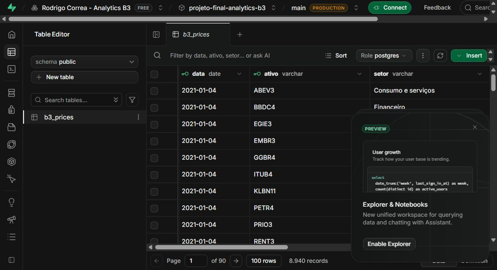
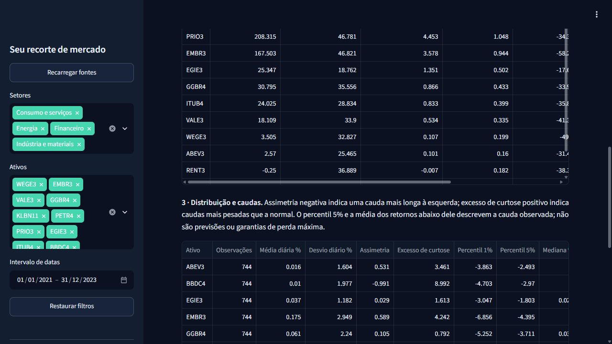

# Evidências de validação

Verificação local realizada em **30/10/2026**, na raiz do projeto.
Publicação e conferência final realizadas em **31/10/2026**.

## Resultado

| Verificação | Resultado observado |
| --- | --- |
| Aquisição Yahoo | 12 ativos, 8.940 linhas, 745 pregões por ativo |
| Cobertura | 247 pregões em 2021; 250 em 2022; 248 em 2023 |
| Intervalo efetivo | 04/01/2021 a 28/12/2023 |
| Integridade | SHA-256 do CSV conferido contra o manifesto |
| Testes locais | **41 passaram**, 1 teste de integração ignorado localmente |
| CI Python 3.11 | Lint, formatação e testes aprovados |
| CI Python 3.12 | Lint, formatação e testes aprovados |
| CI PostgreSQL 16 | Carga, leitura, atualização e idempotência aprovadas |
| Ruff lint | All checks passed |
| Ruff format | Formatação aprovada |
| Compilação Python | app, src e tests sem erro de sintaxe |
| Dependências | pip check: No broken requirements found |
| Notebook | Estrutura válida; 9 células de código executadas sem erro |
| Interface | Dashboard carregado no navegador com dados reais e fonte CSV |
| Publicação | Acesso público sem login, com fonte PostgreSQL no Supabase |
| Exportação pública | Filtro Energia: 2.235 registros, EGIE3/PETR4/PRIO3, UTF-8 com BOM |
| Reset público | Retorno aos 12 ativos e ao período completo |
| Console do navegador | Nenhum erro ou aviso registrado durante a conferência |
| Secrets | secrets.toml e .venv confirmados no gitignore |

O ambiente isolado local utiliza Python **3.14.3**. Dependências principais:
Streamlit 1.66.1, pandas 3.1.0, NumPy 2.5.4, Plotly 6.9.0,
yfinance 1.7.0, SQLAlchemy 2.1.6, psycopg 3.3.6 e pytest 9.2.0.
Os intervalos de versões para instalação estão em requirements.txt e requirements-dev.txt.
A matriz de CI para Python 3.11/3.12 e um job com PostgreSQL 16 foram preparados.
Os três jobs passaram no commit `03d1d74`, incluindo os testes adicionais de
razões de retorno/risco, caudas e divisão por risco nulo. A
[execução verificada](https://github.com/rodrigodll46/projeto-final-analytics-b3/actions/runs/41217693313)
registra os resultados. A integração identificou e permitiu corrigir o cache SQL
que devolvia resultados antigos após uma carga; o teste passou após a correção.

## O que os testes verificam

- Retornos conhecidos, base 100, drawdown e volatilidade amostral anualizada.
- Carteira com pesos iguais no início e sem rebalanceamento.
- Primeiro retorno excluído do recorte, SMA com histórico e ausência de look-ahead.
- Rejeição de dados inválidos, nulos, duplicatas, universo ou cobertura incompletos.
- Prioridade do banco, contingência CSV, falha de ambas as fontes e mensagens sem secrets.
- Atualização do cache quando o snapshot local muda.
- Contrato do download, tentativas, alias histórico da Embraer e preservação do CSV.
- Correspondência do snapshot entregue com o manifesto.
- Razão de retorno acumulado/risco e Sharpe com rf=0, com fórmulas distintas.
- Assimetria, curtose e quantis conhecidos; séries constantes sem razão/correlação.
- AppTest: quatro métricas, seis gráficos, seis abas, filtros de setor e data, reset,
  seleção vazia e intervalo insuficiente.

Os testes de unidade usam dados sintéticos exclusivamente como fixtures.
O snapshot entregue e o notebook utilizam dados reais do provedor.
O simulador AppTest e o kernel Jupyter precisaram de execução com sockets locais
disponíveis; isso é uma necessidade do ambiente de teste, não uma dependência externa do CSV.

## Resultados analíticos do snapshot completo

| Indicador | Resultado |
| --- | ---: |
| Retorno da carteira com pesos iniciais iguais | 58,41% |
| Maior retorno: PETR4 | 228,69% |
| Menor retorno: BBDC4 | -6,93% |
| Volatilidade média dos ativos | 33,61% a.a. |
| Maior drawdown em magnitude: EMBR3 | -58,27% |

Esses números dependem do snapshot e dos ajustes do Yahoo. Não são resultados
de uma carteira real com custos. As fórmulas e os deltas estão no README e na aplicação.

## Limites da verificação

**Supabase:** projeto `projeto-final-analytics-b3` criado no plano Free, na região
São Paulo. A carga real foi concluída e o comando de validação confirmou
8.940 registros, 12 ativos e igualdade com o snapshot. O papel `b3_reader` foi
criado com autorização do titular da conta. Foram conferidas as permissões:
SELECT permitido e INSERT, UPDATE, DELETE e TRUNCATE negados. A tabela tem RLS
e a Data API está desativada. A credencial administrativa permanece local.
O job de CI usa outro PostgreSQL descartável, sem acessar o banco de produção.

**Git:** repositório público criado em
[rodrigodll46/projeto-final-analytics-b3](https://github.com/rodrigodll46/projeto-final-analytics-b3).
Os commits publicados registram a preparação real da entrega com autoria de Rodrigo Correa,
usando o email noreply da conta autenticada, sem datas retroativas.
Após receber o PDF, as correções foram implementadas em features a partir de
develop e integradas por PRs, com main como branch estável. As branches originais
permanecem. Isso não reconstrói um GitFlow retroativo para as etapas iniciais.

**Publicação Streamlit:** concluída em Python 3.12, usando `app.py`. A conexão
inicial de deploy usa `codex/analytics-b3`, mantida como espelho da versão estável
de `main`, sem force push. URL pública:
[rodrigo-correa-analytics-b3.streamlit.app](https://rodrigo-correa-analytics-b3.streamlit.app/).
O acesso foi conferido em uma sessão sem login. A aplicação exibiu fonte PostgreSQL,
745 pregões e 12 ativos, com os indicadores do snapshot. O filtro Energia reduziu
a seleção a três ativos e o retorno médio a 154,12%. O CSV baixado foi lido e
conferido: 2.235 registros, somente EGIE3/PETR4/PRIO3, datas de 04/01/2021 a
28/12/2023 e codificação UTF-8 com BOM. O botão Restaurar filtros recuperou o
universo completo. Somente a conexão `postgresql` do leitor está nos secrets
da publicação; a conexão administrativa não foi transferida.

**Apresentação:** 9 slides com notas de apresentação, 3 gráficos editáveis e
2 tabelas. Estrutura, fontes e relações dos gráficos com planilhas incorporadas
passaram na validação. As prévias foram revisadas. O arquivo não foi aberto no
Microsoft PowerPoint neste ambiente.
A versão `Apresentacao_Rodrigo_Correa_B3_Revisada.pptx` atualiza a captura do app,
as seis visões e os resultados de Sharpe/resiliência, preservando os nove slides.

**Auditoria da interface publicada:** a versão com seis abas foi conferida sem
login, lendo PostgreSQL. A aba Conclusões exibiu PETR4 com razão acumulada/risco
de 5,80 e Sharpe rf=0 de 1,22, além de estatísticas de cauda e resiliência. O Trello
dedicado também foi aberto sem login, com quatro listas e cartões atribuídos.

**Definições dos dados:** Volume Financeiro é estimado por Close × Volume,
os quatro grupos setoriais são didáticos e EMBR3 usa o histórico migrado para
EMBJ3.SA na aquisição inicial. Essas escolhas estão explícitas nos artefatos.
O PDF original foi recebido em 31/10/2026 e a comparação completa está em
`docs/CHECKLIST_AVALIACAO.md`. O vídeo foi excluído por decisão do autor; o envio
no AVA ainda não tem comprovante.

## Evidência visual

